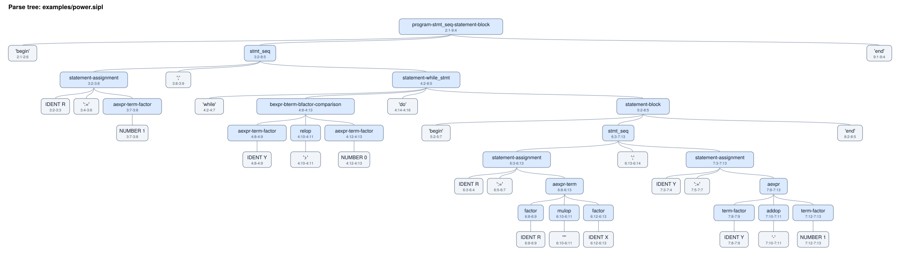

# SIPL: аналізатор семантики та інфраструктура тестування

[](https://github.com/YOUR-GITHUB-USERNAME/sipl-semantics/actions/workflows/ci.yml)
[](https://github.com/YOUR-GITHUB-USERNAME/sipl-semantics/releases)

Консольний застосунок для мови **SIPL** (курс «Теорія програмування»): розбирає програму
в дерево виводу і типізоване AST, автоматично будує **семантичний терм** у нотації курсу,
**покроково обчислює** його на заданому стані з трейсом застосованих правил і
**візуалізує** весь ланцюжок «код → дерево → AST → терм → стани».

```text
$ sipl term examples/power.sipl
AS^R(1̅) • WH(S²(>, Y⇒, 0̅), AS^R(S²(×, R⇒, X⇒)) • AS^Y(S²(−, Y⇒, 1̅)))

$ sipl eval examples/power.sipl --state "X=2, Y=3"
Початковий стан: st0 = [X ↦ 2, Y ↦ 3]
Переходи станів:
   st0 = [X ↦ 2, Y ↦ 3]
   st0 → st1  (AS^R: R ↦ 1)  st1 = [X ↦ 2, Y ↦ 3, R ↦ 1]
   ...
Результат: [X ↦ 2, Y ↦ 0, R ↦ 8]   [46 застосувань правил]
```

## Обрані завдання

Трек «Аналізатор семантики та інфраструктура тестування». Заявлено **11.0 балів**
(зараховується максимум 10.0).

| ID | Завдання | Бали | Де реалізовано |
|---|---|---|---|
| CORE-01 | Формальна специфікація SIPL: машинозчитувана граматика, лексика, тести | 0.5 | `grammar/`, `src/sipl/ebnf.py`, `tests/test_grammar.py` |
| CORE-02 | Парсер і типізоване AST з `SourceSpan`, діагностики | 1.5 | `src/sipl/{lexer,parser,ast,span,diagnostics}.py` |
| CORE-06 | Conformance suite: програми з очікуваним AST, станом, помилками | 1.0 | `conformance/` |
| SEM-01 | Автоматична рекурсивна побудова семантичного терму з AST | 2.0 | `src/sipl/semantics/{terms,builder,render}.py` |
| SEM-02 | Обчислення терму на стані з покроковим трейсом правил | 2.0 | `src/sipl/semantics/{evaluator,state}.py` |
| SEM-03 | Візуалізація ланцюжка код → дерево → AST → терм → стани | 1.5 | `src/sipl/visualization/html.py` (`sipl visualize`) |
| VIS-01 | Дерево синтаксичного виводу (text/JSON/DOT/SVG), зв'язок з кодом | 1.5 | `src/sipl/visualization/` (`sipl tree`) |
| REL-01 | CI на кожен Pull Request | 0.5 | `.github/workflows/ci.yml` |
| REL-02 | GitHub Releases + SemVer + CHANGELOG | 0.5 | `.github/workflows/release.yml`, `CHANGELOG.md` |
| | **Разом** | **11.0** | |

Відповідність критеріям готовності - у розділі [«Критерії готовності»](#критерії-готовності).

## Встановлення

Потрібен **Python 3.10+**. Зовнішніх залежностей немає.

```bash
git clone https://github.com/YOUR-GITHUB-USERNAME/sipl-semantics.git
cd sipl-semantics
python -m venv .venv
# Windows:      .venv\Scripts\activate
# macOS/Linux:  source .venv/bin/activate
pip install -e .
sipl --version
```

Без встановлення (з кореня репозиторію): `python -m sipl ...` після
`set PYTHONPATH=src` (Windows) або `export PYTHONPATH=src` (macOS/Linux).

Для розробки (тести, лінтер, типи): `pip install -e ".[dev]"`.

## Швидкий старт

```bash
sipl check examples/power.sipl                          # синтаксис
sipl check examples/syntax_error.sipl                   # діагностика з позицією
sipl tree examples/max.sipl                             # дерево виводу (текст)
sipl tree examples/power.sipl -f svg --compact -o tree.svg
sipl parse examples/gcd.sipl                            # AST
sipl term examples/power.sipl --steps                   # як будується терм
sipl term examples/power.sipl --style latex             # терм для звіту в LaTeX
sipl eval examples/gcd.sipl -s "X=12, Y=18" --explain   # покрокове обчислення
sipl eval examples/div_by_zero.sipl -s "X=1, Y=0" -e -a # ⊥ і де саме він виник
sipl visualize examples/power.sipl -s "X=2, Y=3" --open # інтерактивна HTML-сторінка
sipl eval -c "X := 6 * 7"                               # код прямо в командному рядку
```

Повний довідник команд - [`docs/cli.md`](docs/cli.md); приклади - [`examples/`](examples/README.md).

## Мова SIPL

```
програма   ::= оператор { ; оператор }
оператор   ::= x := ар.вираз | if умова then оператор else оператор
             | while умова do оператор | begin оператор {; оператор} end | skip
ар.вираз   ::= n | x | ар.вираз (+ | - | * | /) ар.вираз | ( ар.вираз )
умова      ::= true | false | ар.вираз (< | <= | = | <> | > | >=) ар.вираз
             | умова and умова | умова or умова | not умова | ( умова )
```

Формальна граматика: [`grammar/sipl.ebnf`](grammar/sipl.ebnf); лексика і синоніми
(`÷`, `≤`, `∧`, `¬`, `&&`, ...): [`grammar/LEXICAL.md`](grammar/LEXICAL.md).
Коментарі: `// ...` та `{ ... }`.

## Семантичні терми та обчислення

| SIPL | Терм |
|---|---|
| `x := a` | `AS^x(⟦a⟧)` |
| `S1; S2` | `⟦S1⟧ • ⟦S2⟧` |
| `if b then S1 else S2` | `IF(⟦b⟧, ⟦S1⟧, ⟦S2⟧)` |
| `while b do S` | `WH(⟦b⟧, ⟦S⟧)` |
| `skip` | `id` |
| `x`, `n` | `x⇒`, `n̅` |
| `a1 + a2`, `not b` | `S²(+, ⟦a1⟧, ⟦a2⟧)`, `S¹(¬, ⟦b⟧)` |

Правила обчислення (`AS`, `SEQ`, `IF-T/F`, `WH-T/F`, `DEN`, ...), невизначеність `⊥` і
межі автоматизації описані в [`docs/semantics.md`](docs/semantics.md).

## Візуалізація

`sipl visualize FILE -s "..."` створює один HTML-файл без зовнішніх ресурсів.
Клік по символу коду, вузлу дерева виводу, вузлу AST, підтерму або кроку трейсу
підсвічує відповідні елементи на всіх рівнях; кнопки ◀ ▶ програють обчислення
по кроках і показують стан до/після кожного правила.


Дерево синтаксичного виводу в SVG (`sipl tree examples/power.sipl -f svg --compact`):



## Тестування

```bash
pytest                                        # 175 тестів: граматика, парсер, терми, обчислення, CLI
pytest --cov=sipl --cov-branch                # покриття (у CI поріг 90 %)
python conformance/run_conformance.py         # conformance suite: 54 кейси
ruff check src tests conformance && mypy      # стиль і типи
UPDATE_GOLDEN=1 pytest tests/test_terms.py    # перегенерувати golden-файли термів
```

| Набір | Що перевіряє |
|---|---|
| `tests/test_grammar.py` | граматика ↔ парсер на 13 коректних і 16 некоректних програмах, на conformance-кейсах і 300 випадкових реченнях граматики |
| `tests/test_parser.py` | токени, позиції, форма AST, пріоритети/асоціативність, 12 типів діагностик |
| `tests/test_terms.py` | правила побудови термів, нотації, зв'язок терм ↔ AST, golden-тести всіх прикладів |
| `tests/test_evaluator.py` | значення, трейс правил, ⊥ (змінна, ділення, ліміт), логіка Кліні, формати станів |
| `tests/test_visualization.py` | text/JSON/DOT/SVG/HTML будуються з реальних даних і узгоджені між собою |
| `tests/test_cli.py` | усі команди, формати і коди завершення |
| `tests/test_conformance.py` | запуск suite через CLI-адаптер; runner ловить хибні очікування |

Формат conformance-кейсів і протокол для інших реалізацій: [`conformance/README.md`](conformance/README.md).

## CI та релізи

* **CI** (`.github/workflows/ci.yml`) - на кожен push і Pull Request: ruff, mypy, pytest з
  покриттям ≥ 90 % (Ubuntu × Python 3.10–3.13, Windows, macOS), conformance suite,
  збірка wheel і запуск у чистому venv.
* **Release** (`.github/workflows/release.yml`) - на тег `vX.Y.Z`: перевірка, що тег збігається
  з версією пакета, тести, збірка `sdist`/`wheel`, демо-візуалізації, release notes з
  [`CHANGELOG.md`](CHANGELOG.md), публікація GitHub Release з артефактами.

Випуск нової версії: оновити версію в `pyproject.toml` і `src/sipl/__init__.py`, додати
розділ у `CHANGELOG.md`, потім `git tag -a v1.1.0 -m "v1.1.0" && git push origin v1.1.0`.

## Архітектура

```
grammar/        формальна граматика EBNF, лексика, корпус коректних/некоректних програм
src/sipl/       lexer → parser → CST → AST → semantics (terms, evaluator) → visualization, cli
conformance/    незалежний conformance suite і runner
examples/       приклади SIPL
tests/          pytest + golden-файли
docs/           архітектура, семантика, CLI
```

Детально - [`docs/architecture.md`](docs/architecture.md).

## Критерії готовності

| ID | Критерій | Як виконано |
|---|---|---|
| CORE-01 | граматика відповідає БНФ курсу; ≥10 позитивних і ≥10 негативних тестів | `sipl.ebnf` - стратифікована (однозначна) форма БНФ курсу з поясненням відповідності; 13 + 16 програм, перевірених і генеричним EBNF-розпізнавачем, і парсером |
| CORE-02 | власні AST-вузли, коректні діагностики | dataclass-вузли з `id` та `SourceSpan`; 17 кодів помилок (E001–E004, E100–E112) з рядком/колонкою, фрагментом і підказкою |
| CORE-06 | запуск незалежно від реалізації; документація формату | runner без імпорту `sipl`, протокол через CLI, `conformance/README.md` + `schema.json` |
| SEM-01 | терм рекурсивно з AST; усі оператори; golden tests | `semantics/builder.py`, `sipl term --steps`, `tests/golden/*.term.txt` |
| SEM-02 | вхід: терм + стан; вихід: стан або ⊥ + трейс правил | `semantics/evaluator.py`, `sipl eval --explain [--all-rules] [--json]` |
| SEM-03 | відповідність елементів між рівнями; вибір вузла синхронізує подання | `sipl visualize` |
| VIS-01 | Text + JSON + DOT/SVG; вузли пов'язані з кодом | `sipl tree -f text\|json\|dot\|svg\|html` |
| REL-01 | CI на чистому середовищі, статус у README | `ci.yml`, бейдж угорі |
| REL-02 | тегований release з notes і артефактами | `release.yml`, `CHANGELOG.md`, тег `v1.0.0` |

## Обмеження

* Завершуваність програм не вирішується (це алгоритмічно нерозв'язно): для циклів діє ліміт
  кроків (`--max-steps`), після якого результат - `⊥` з кодом `STEP_LIMIT`.
* Значення - необмежені цілі числа Python; `÷` - цілочисельне ділення з округленням до нуля.
* Парсер зупиняється на першій синтаксичній помилці (без відновлення).
* `begin … end` не має власного терму: `⟦begin S end⟧ = ⟦S⟧`.

## Ліцензія

MIT, див. [`LICENSE`](LICENSE).
