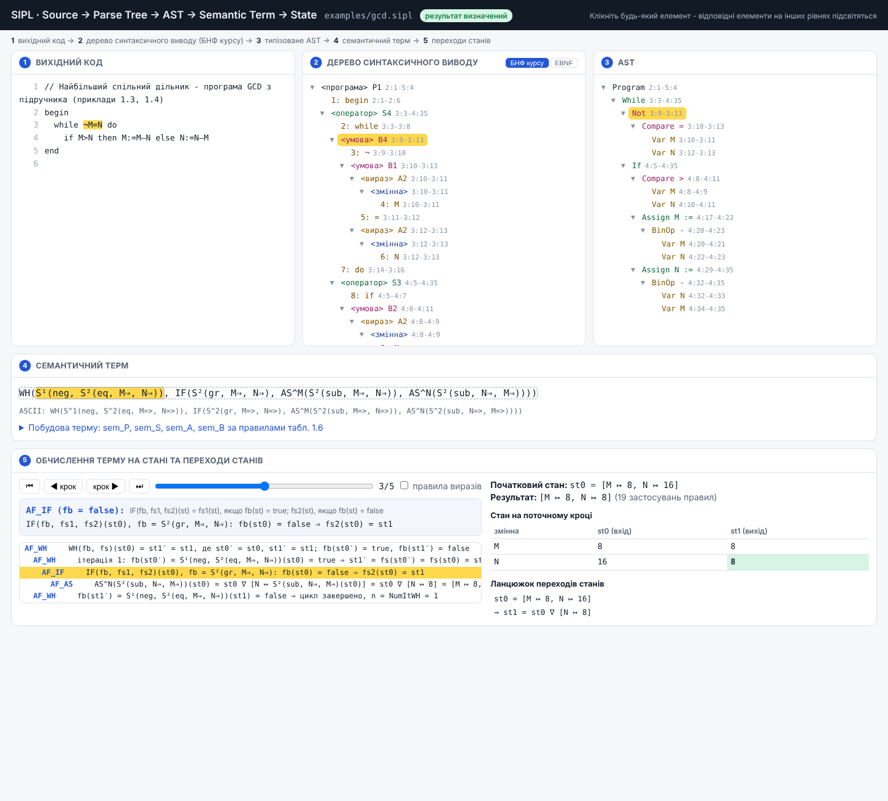

# SIPL: аналізатор семантики та інфраструктура тестування

[](https://github.com/YOUR-GITHUB-USERNAME/sipl-semantics/actions/workflows/ci.yml)
[](https://github.com/YOUR-GITHUB-USERNAME/sipl-semantics/releases)

Консольний застосунок для мови **SIPL** (курс «Теорія програмування»): розбирає програму
в дерево виводу і типізоване AST, автоматично будує **семантичний терм** у нотації курсу,
**покроково обчислює** його на заданому стані з трейсом застосованих правил і
**візуалізує** весь ланцюжок «код → дерево → AST → терм → стани».

Синтаксис і семантика відповідають підручнику М.С. Нікітченка (розд. 1.2–1.3) і практикуму
(ПР 1–2): БНФ табл. 1.4, правила побудови термів табл. 1.6, формули обчислення табл. 1.5,
строга частковість (Зауваження 1.6). Детально - [`docs/theory.md`](docs/theory.md).

```text
$ sipl term examples/power.sipl
AS^R(1̅) • WH(S²(gr, Y⇒, 0̅), AS^R(S²(mult, R⇒, X⇒)) • AS^Y(S²(sub, Y⇒, 1̅)))

$ sipl eval examples/power.sipl --state "X=5, Y=2"
Початковий стан: st0 = [X ↦ 5, Y ↦ 2]
Переходи станів:
   st0 = [X ↦ 5, Y ↦ 2]
   st0 → st1  (AS^R: R ↦ 1)  st1 = [X ↦ 5, Y ↦ 2, R ↦ 1]
   ...
Результат: [X ↦ 5, Y ↦ 0, R ↦ 25]   [34 застосувань правил]
```

## Обрані завдання

Трек «Аналізатор семантики та інфраструктура тестування». Заявлено **11.0 балів**
(зараховується максимум 10.0).

| ID | Завдання | Бали | Де реалізовано |
|---|---|---|---|
| CORE-01 | Формальна специфікація SIPL: машинозчитувана граматика, лексика, тести | 0.5 | `grammar/`, `src/sipl/ebnf.py`, `tests/test_grammar.py` |
| CORE-02 | Парсер і типізоване AST з `SourceSpan`, діагностики | 1.5 | `src/sipl/{lexer,parser,ast,span,diagnostics}.py` |
| CORE-06 | Conformance suite: програми з очікуваним AST, станом, помилками | 1.0 | `conformance/` |
| SEM-01 | Автоматична рекурсивна побудова семантичного терму з AST | 2.0 | `src/sipl/semantics/{terms,builder,render}.py` |
| SEM-02 | Обчислення терму на стані з покроковим трейсом правил | 2.0 | `src/sipl/semantics/{evaluator,state}.py` |
| SEM-03 | Візуалізація ланцюжка код → дерево → AST → терм → стани | 1.5 | `src/sipl/visualization/html.py` (`sipl visualize`) |
| VIS-01 | Дерево синтаксичного виводу (text/JSON/DOT/SVG), зв'язок з кодом | 1.5 | `src/sipl/visualization/` (`sipl tree`) |
| REL-01 | CI на кожен Pull Request | 0.5 | `.github/workflows/ci.yml` |
| REL-02 | GitHub Releases + SemVer + CHANGELOG | 0.5 | `.github/workflows/release.yml`, `CHANGELOG.md` |
| | **Разом** | **11.0** | |

Відповідність критеріям готовності - у розділі [«Критерії готовності»](#критерії-готовності).

## Встановлення

Потрібен **Python 3.10+**. Зовнішніх залежностей немає.

```bash
git clone https://github.com/YOUR-GITHUB-USERNAME/sipl-semantics.git
cd sipl-semantics
python -m venv .venv
# Windows:      .venv\Scripts\activate
# macOS/Linux:  source .venv/bin/activate
pip install -e .
sipl --version
```

Без встановлення (з кореня репозиторію): `python -m sipl ...` після
`set PYTHONPATH=src` (Windows) або `export PYTHONPATH=src` (macOS/Linux).

Для розробки (тести, лінтер, типи): `pip install -e ".[dev]"`.

## Швидкий старт

```bash
sipl check examples/power.sipl --strict                 # синтаксис (лише мова ядра курсу)
sipl check examples/syntax_error.sipl                   # діагностика з позицією
sipl tree examples/power.sipl                           # дерево виводу як у ПР 1 + обхід листків
sipl tree examples/power.sipl -f svg -o tree.svg        # те саме дерево в SVG
sipl parse examples/gcd.sipl                            # AST
sipl term examples/power.sipl --steps                   # побудова терму за правилами табл. 1.6
sipl term examples/power.sipl --style latex             # терм для звіту в LaTeX
sipl eval examples/power.sipl -s "X=5, Y=2" --explain   # обчислення за формулами AF_* (як у ПР 2)
sipl eval examples/gcd.sipl -s "M=8, N=16" -e -a        # приклад 1.4 підручника
sipl eval examples/div_by_zero.sipl -s "X=1, Y=0" -e -a # ⊥ і де саме він виник
sipl visualize examples/power.sipl -s "X=5, Y=2" --open # інтерактивна HTML-сторінка
sipl eval -c "begin X := 6 * 7 end"                     # код прямо в командному рядку
```

Повний довідник команд - [`docs/cli.md`](docs/cli.md); приклади - [`examples/`](examples/README.md).

## Мова SIPL

БНФ курсу (Нікітченко, табл. 1.4):

```
P ::= begin S end
S ::= x := a | S1 ; S2 | if b then S1 else S2 | while b do S | begin S end | skip
a ::= n | x | a1 + a2 | a1 – a2 | a1 * a2 | (a)          n ::= … –1 | 0 | 1 | 2 | …
b ::= a1 = a2 | a1 > a2 | b1 ∨ b2 | ¬b | (b)
```

Неоднозначність усунено пріоритетами підручника (`*`; `+ –`; `= >`; `¬`; `∨`; `:=`; `while`;
`if`; `;`) і лівою асоціативністю. Тому гілки `if` і тіло `while` - один оператор, а
`if b then S1 else S2; S3` = `(if …); S3`.

* [`grammar/sipl.ebnf`](grammar/sipl.ebnf) - формальна граматика **ядра курсу** (однозначна форма БНФ);
* [`grammar/sipl-ext.ebnf`](grammar/sipl-ext.ebnf) - **розширення**, якими користується практикум:
  `<`, `≤`, `≠`, `≥` (функція `gre`), `∧`, `true`/`false`, `div`, `mod`. Вони приймаються з
  попередженням `W201`; з `--strict` - лише ядро курсу;
* [`grammar/LEXICAL.md`](grammar/LEXICAL.md) - лексика: варіанти символів з підручника
  (`–`, `∗`, `¬`, `∨`) і ASCII-відповідники (`-`, `*`, `not`, `or`), коментарі `//` і `{ }`.

## Семантичні терми та обчислення

| SIPL | Терм (правило табл. 1.6) |
|---|---|
| `begin S end` (програма) | `sem_S(S)` (NS_Prog) |
| `x := a` | `AS^x(sem_A(a))` (NS_Stm_As) |
| `S1; S2` | `sem_S(S1) • sem_S(S2)` (NS_Stm_Seq) |
| `if b then S1 else S2` | `IF(sem_B(b), sem_S(S1), sem_S(S2))` (NS_Stm_If) |
| `while b do S` | `WH(sem_B(b), sem_S(S))` (NS_Stm_Wh) |
| `skip` | `id` (NS_Stm_skip) |
| `n`, `x` | `n̅`, `x⇒` (NS_A_Num, NS_A_Var) |
| `a1 + a2`, `a1 – a2`, `a1 * a2` | `S²(add, …)`, `S²(sub, …)`, `S²(mult, …)` |
| `a1 = a2`, `a1 > a2`, `b1 ∨ b2`, `¬b` | `S²(eq, …)`, `S²(gr, …)`, `S²(or, …)`, `S¹(neg, …)` |

Обчислення - за формулами табл. 1.5 (`AF_S`, `AF_AS`, `AF_SEQ`, `AF_IF`, `AF_WH`, `AF_DNM`,
`AF_ID`) зі строгою частковістю (Зауваження 1.6). Деталі й межі автоматизації -
[`docs/semantics.md`](docs/semantics.md).

## Візуалізація

`sipl visualize FILE -s "..."` створює один HTML-файл без зовнішніх ресурсів.
Клік по символу коду, вузлу дерева виводу, вузлу AST, підтерму або кроку трейсу
підсвічує відповідні елементи на всіх рівнях; кнопки ◀ ▶ програють обчислення
по кроках і показують стан до/після кожного правила.



Дерево синтаксичного виводу (`sipl tree examples/power.sipl -f svg`, як у ПР 1):


## Тестування

```bash
pytest                                        # 214 тестів: граматика, парсер, терми, обчислення, CLI
pytest --cov=sipl --cov-branch                # покриття (у CI поріг 90 %)
python conformance/run_conformance.py         # conformance suite: 59 кейсів
ruff check src tests conformance && mypy      # стиль і типи
UPDATE_GOLDEN=1 pytest tests/test_terms.py    # перегенерувати golden-файли термів
```

| Набір | Що перевіряє |
|---|---|
| `tests/test_grammar.py` | множина терміналів = БНФ курсу; граматики ↔ парсер (зокрема `--strict`) на 15 програмах ядра, 10 з розширеннями, 18 некоректних, на conformance-кейсах і 2×300 випадкових реченнях |
| `tests/test_parser.py` | токени, типографія підручника, позиції, форма AST, пріоритети/асоціативність, від'ємні числа, 15 типів діагностик |
| `tests/test_terms.py` | правила табл. 1.6, еталонні терми підручника (прикл. 1.2, 1.3) і практикуму, кроки побудови, golden-тести |
| `tests/test_evaluator.py` | формули табл. 1.5, приклади ПР 2 і 1.4, строга частковість, ⊥, формати станів |
| `tests/test_visualization.py` | text/JSON/DOT/SVG/HTML будуються з реальних даних і узгоджені між собою |
| `tests/test_cli.py` | усі команди, формати і коди завершення |
| `tests/test_conformance.py` | запуск suite через CLI-адаптер; runner ловить хибні очікування |

Формат conformance-кейсів і протокол для інших реалізацій: [`conformance/README.md`](conformance/README.md).

## CI та релізи

* **CI** (`.github/workflows/ci.yml`) - на кожен push і Pull Request: ruff, mypy, pytest з
  покриттям ≥ 90 % (Ubuntu × Python 3.10–3.13, Windows, macOS), conformance suite,
  збірка wheel і запуск у чистому venv.
* **Release** (`.github/workflows/release.yml`) - на тег `vX.Y.Z`: перевірка, що тег збігається
  з версією пакета, тести, збірка `sdist`/`wheel`, демо-візуалізації, release notes з
  [`CHANGELOG.md`](CHANGELOG.md), публікація GitHub Release з артефактами.

Випуск нової версії: оновити версію в `pyproject.toml` і `src/sipl/__init__.py`, додати
розділ у `CHANGELOG.md`, потім `git tag -a v1.1.0 -m "v1.1.0" && git push origin v1.1.0`.

## Архітектура

```
grammar/        формальна граматика EBNF, лексика, корпус коректних/некоректних програм
src/sipl/       lexer → parser → CST → AST → semantics (terms, evaluator) → visualization, cli
conformance/    незалежний conformance suite і runner
examples/       приклади SIPL
tests/          pytest + golden-файли
docs/           відповідність теорії курсу, архітектура, семантика, CLI
```

Детально - [`docs/architecture.md`](docs/architecture.md).

## Критерії готовності

| ID | Критерій | Як виконано |
|---|---|---|
| CORE-01 | граматика відповідає БНФ курсу; ≥10 позитивних і ≥10 негативних тестів | `sipl.ebnf` - однозначна форма БНФ табл. 1.4 (тест: множина терміналів збігається), розширення окремо; 15 + 10 + 18 програм, перевірених генеричним EBNF-розпізнавачем і парсером |
| CORE-02 | власні AST-вузли, коректні діагностики | dataclass-вузли з `id` та `SourceSpan`; 17 кодів помилок (E001–E004, E100–E112) з рядком/колонкою, фрагментом і підказкою |
| CORE-06 | запуск незалежно від реалізації; документація формату | runner без імпорту `sipl`, протокол через CLI, `conformance/README.md` + `schema.json` |
| SEM-01 | терм рекурсивно з AST; усі оператори; golden tests | правила табл. 1.6 (`NS_*`), `sipl term --steps`, еталонні терми підручника/практикуму, `tests/golden/*.term.txt` |
| SEM-02 | вхід: терм + стан; вихід: стан або ⊥ + трейс правил | формули табл. 1.5 (`AF_*`), `sipl eval --explain [--all-rules] [--json]` |
| SEM-03 | відповідність елементів між рівнями; вибір вузла синхронізує подання | `sipl visualize` |
| VIS-01 | Text + JSON + DOT/SVG; вузли пов'язані з кодом | дерево за БНФ курсу (`<оператор>`, S1–S6, нумерація листків) і за EBNF: `sipl tree -f text\|json\|dot\|svg\|html` |
| REL-01 | CI на чистому середовищі, статус у README | `ci.yml`, бейдж угорі |
| REL-02 | тегований release з notes і артефактами | `release.yml`, `CHANGELOG.md`, теги `v1.0.0`, `v2.0.0` |

## Обмеження

* Завершуваність програм не вирішується (це алгоритмічно нерозв'язно): для циклів діє ліміт
  кроків (`--max-steps`), після якого результат - `⊥` з кодом `STEP_LIMIT`.
* Значення - необмежені цілі числа (`Int` підручника); `div`/`mod` (розширення) - з округленням вниз.
* Парсер зупиняється на першій синтаксичній помилці (без відновлення).
* `begin … end` не має власного терму: `sem_S(begin S end) = (sem_S(S))`.

## Ліцензія

MIT, див. [`LICENSE`](LICENSE).
